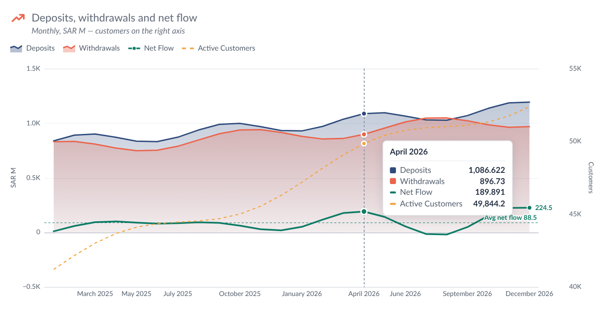

# Line Chart — Tableau Viz Extension

A line and area chart for any number of measures over a date: each measure is a line or an area, with an optional
Color dimension, stacked and 100% areas, a dual axis, reference lines, a band between two measures, a forecast zone
and an interactive legend. The icon, title, explanation and card options are the same as **KPI Card 3** and
**Waterfall**, and so is the number formatting.



```
line-chart.trex  manifest: Marks card tiles + "Format Extension" button
index.html       chart page
chart.css/js     header, legend, data reading, chart drawing, crosshair tooltip, right-click menu
configure.*      Format dialog (every option below)
config.js        shared defaults, palettes, number formatting
icons.js, icons/extension/ the 14 Figma icons from *Icons for Extension* (same files as KPI Card)
fonts/           Lato 2.0 (OFL), WOFF2 Latin subset (~38 KB per weight)
serve.py/.sh     local server on :8768, also lists Tableau shape palettes
dev/             browser preview with sample data (no Tableau needed)
```

## Run it

```bash
chmod +x serve.sh && ./serve.sh
```

In Tableau Desktop (2024.2+): Marks card → mark type dropdown → **Add Extension** → **Access Local Extensions** →
`Line Chart localhost.trex` (in the `tableau-extensions` folder).

To try it without Tableau, open <http://localhost:8768/dev/preview.html>. It has seven sample data sets (monthly flows
with areas, lines and a dual axis; transactions by channel with a Color dimension; actual + forecast with a band;
daily raw SAR values with exact dates and weekend gaps; YEAR + MONTH pills as percentages; negative values; no date)
and opens the Format dialog next to the chart. Each data set keeps its own settings; some start with settings that
show off a feature. **Reset settings** brings those back.

| Marks card tile | What to drop | Drives |
| --- | --- | --- |
| **Date** | one or more date fields at any level (YEAR, QUARTER, MONTH, WEEK, DAY, exact date), or any other dimension (up to 4) | the horizontal axis. Several date parts (e.g. YEAR + MONTH) are combined and sorted by date whatever order you drop them in |
| **Measures** | one measure per series, dropped **one at a time** (up to 20) | the lines and areas, in the order of the pills on the tile |
| **Color** | one dimension (optional) | splits every measure into one series per member, e.g. by channel |

- Rows that share the same date (and Color member) are added up.
- Missing values leave a gap, connect across, or count as zero (Format → Series → Chart).
- With exact dates you can space points by their real distance in time instead of evenly.
- If Tableau delivers the measures as *Measure Names / Measure Values*, the extension pivots them back. Nothing to do.

## Interacting

- **Hover** anywhere in the chart: a crosshair snaps to the nearest date and the tooltip lists every series at that
  point with full, unabbreviated values (Tableau's own format when the point is a single value), plus the stacked
  total, each area's share with 100% stacking, and the band range.
- **Legend**: click an item to hide or show that series, hover to highlight it, double-click to format it. Hiding
  is for this session only; to hide a series for everyone, set it to *Hidden* in Format → Series.
- **Right-click** a line, an area or a legend item → *Format "Deposits"…*, *Hide "Deposits"*, Series…, Areas &
  stacking…, Reference lines & band…, Axes…, Lines…, Legend & tooltip…, Numbers…. **Double-click** a line opens its
  settings directly. (Viz extensions can't add entries to Tableau's own right-click menu.)
- **Format Extension** button at the bottom of the Marks card opens the same dialog.

The dialog is modeless, so the chart updates as you change things. **Cancel** undoes everything since the dialog
opened, and **Reset tab** restores the defaults for that tab.

| Tab | Options |
| --- | --- |
| Icon | as KPI Card 3: built-in Figma icons, Tableau shapes, upload, size, colour. Default icon: line chart |
| Title & text | as KPI Card 3. An empty title shows the measure names ("Deposits vs Withdrawals") |
| Series | pick **All series (defaults)** or one series, then: label · **draw as line, area or hidden** · colour (or the palette colour) · **left or right axis** (dual axis) · width · solid / dashed / dotted · straight / smooth / step · **dash the last N segments** (e.g. an incomplete month) · markers (none, every point, last, highest and lowest) and their size · **value labels** (none, last value right of the line, every point, highest and lowest, first and last) with size, weight and colour. **Chart:** palette (House, Tableau 10, Color blind, Blues, Warm), missing values, even or by-date spacing |
| Areas | overlap · **stacked** · **100% stacked** · fill opacity · gradient fill · outline on/off · a quick line / area / hidden switch for every series |
| Reference lines | any number of horizontal lines: **constant (target)**, average, median, min, max or latest value, of one series or of every visible series on an axis · label, show value, label side, colour, width, style, text size. **Band between two measures:** pick a lower and an upper measure (e.g. *Forecast Low* / *Forecast High*), name, colour, opacity, hide the two lines, dashed edges. **Forecast / projection:** pick the first forecast point; from there lines are dashed on a shaded background with a label |
| Axes | **Left and right axis**, each: starts at zero / close to the data (room around the data, %) / fixed value · fixed or automatic maximum · tick count · title (e.g. *SAR M*) · font, size, weight, colour · axis line · own number format or the shared one. **Horizontal:** labels on/off, horizontal / angled / vertical (labels that don't fit are skipped; the last point is always labelled), title, font, axis line, tick marks |
| Lines | horizontal gridlines, vertical gridlines, zero line, hover crosshair: each with show, colour, width, solid / dashed / dotted |
| Legend & tooltip | legend on/off, top / bottom / right, alignment, click to hide / show, **latest value** next to each name, font · tooltip on/off, row order, full numbers, stacked total · fade other series on legend hover · right-click menu |
| Numbers | K / M / B / Dynamic / full / Percentage / Percentage dynamic / workbook format · 0–1 ratio · decimals · unit text and position · "+" on positive values · negatives as −201.4, -201.4 or (201.4) · chart font |
| Card | as KPI Card 3: padding, space above the chart, dashed divider, background colour and opacity |

### Areas, stacking and the axes

Areas always fill down to zero, so an axis with an area on it starts at zero even when set to *Close to the data*.
Stacking happens per axis, in Marks card order. With **100% stacked**, the areas take the left axis (0–100%) and any
lines move to the right axis.

## Settings and deploying

Series settings are stored by the pill's name (e.g. `SUM(Deposits)`), or `SUM(Transactions) · App` with a Color
dimension. Everything is saved in the workbook.

**Renaming pills.** Renaming a measure pill (double-click, type `//New name`, Shift+Enter) keeps its settings, its
Color-member settings, and the band and reference lines that use it: the chart remembers the pill names it last saw,
and a name that disappears while a new one appears in the same place is treated as a rename. The data column is then
found by position when Tableau reports it under another name (the console logs *matched renamed fields by position*).

1. The Tableau Extensions API library is bundled in `lib/tableau.extensions.1.17.0.min.js` (no CDN). To upgrade, replace that file and update the `<script>` path in `index.html` and `configure.html`.
2. Hosting is GitHub Pages (repo `Cobani/line_chart_extension`). Run `python3 stamp-versions.py` before every commit so browsers never mix old and new files.
3. Add the URL to the Tableau Server/Cloud extension safe list. `dev/` doesn't need to be deployed.

Tableau reads the `.trex` only when the extension is added, so after editing it, remove the extension and add it again.

### Fast reload (last-render cache)

After each successful render the extension saves its result in the browser (localStorage, per Tableau Server and worksheet name). On the next load it draws that saved result right after the Tableau handshake, then replaces it with the live data. If the fields on the Marks card have changed since it was saved, the saved drawing is removed as soon as Tableau reports the fields. Saved results older than 30 days are ignored; it never leaves the browser, and clearing site data removes it.

### Load timings (debug)

To see where load time goes, open the dashboard, open DevTools, pick this extension's frame in the Console's context dropdown, run `localStorage.setItem('extDebug', '1')` and reload. Each load then prints a table of steps (page received, API library loaded, Tableau handshake, fields received, data received with row count, cached/live result drawn) plus every file with its download time and whether it came from the browser cache. Later refreshes (filters etc.) print one line each. `extTimings()` prints the table on demand; `localStorage.removeItem('extDebug')` turns it off. In the dev preview, add `?debug` to the URL instead.
